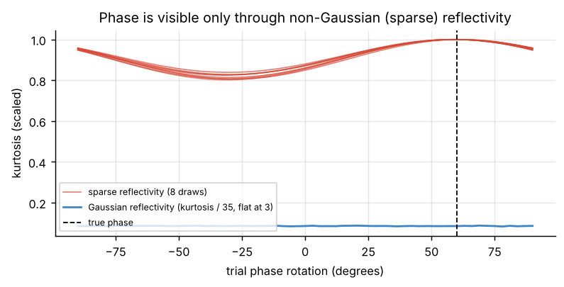
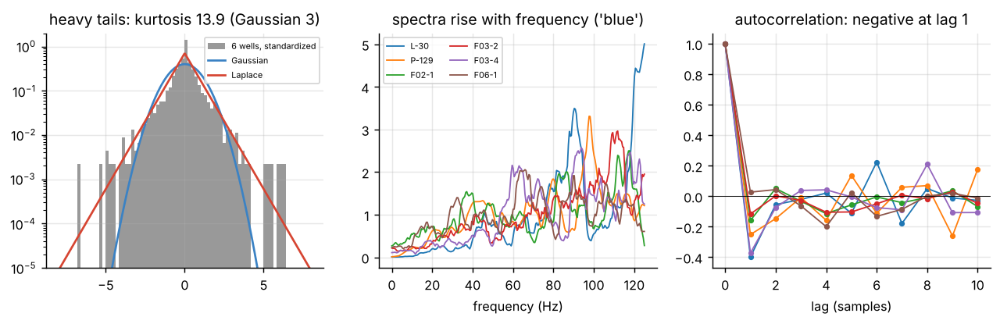
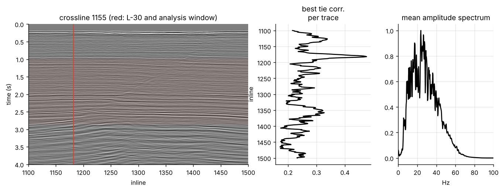
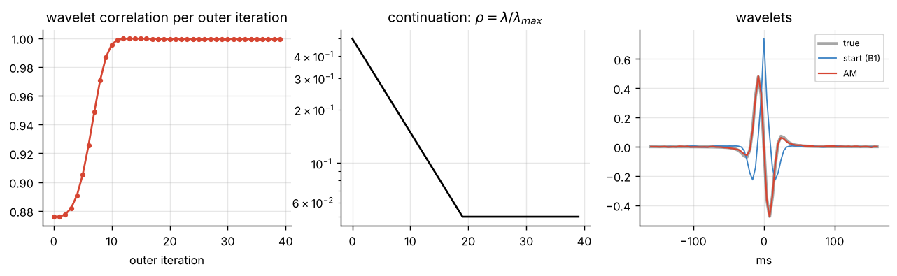
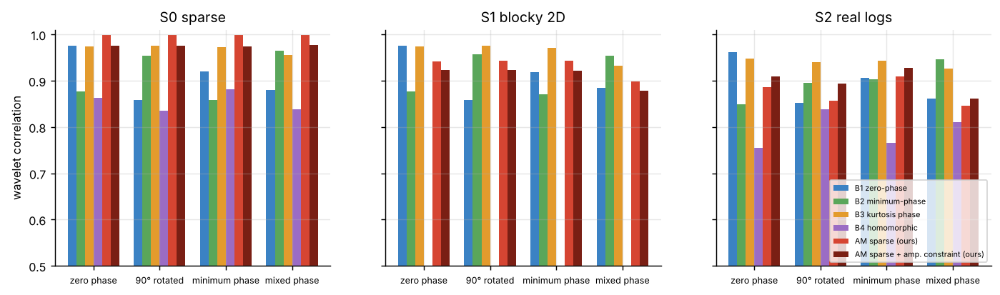
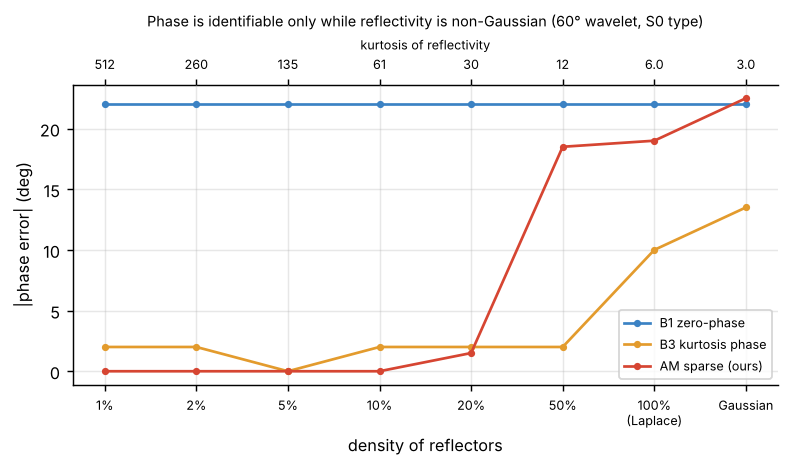
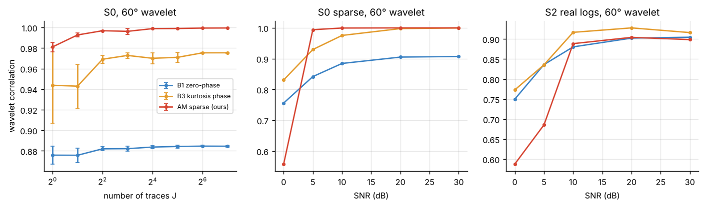
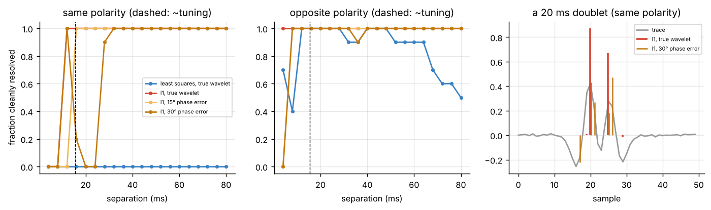
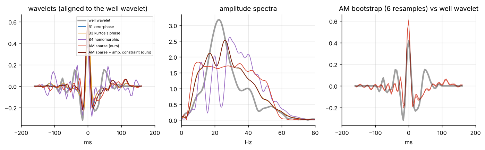
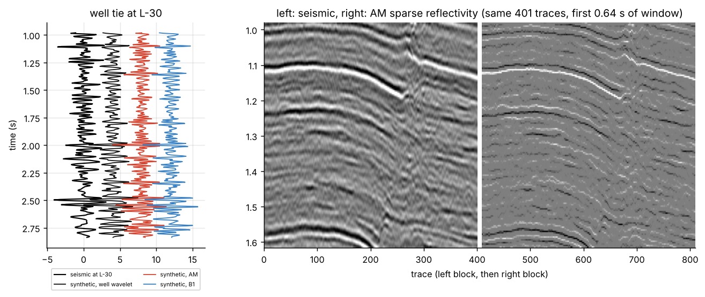

# Multichannel sparse blind deconvolution of seismic data

Recovering an unknown seismic wavelet and a sparse reflectivity from the traces alone, built from first principles and tested against classical methods on synthetic data, real well-log reflectivity, and a real seismic line with a well.

Everything is in one notebook: [`blind_deconvolution.ipynb`](blind_deconvolution.ipynb), with all outputs and figures saved. A plain-Python copy, [`blind_deconvolution.py`](blind_deconvolution.py) (Jupytext percent format), is kept for clean diffs.

This is the seismic follow-up to [DUNL on rainfall and runoff](https://github.com/Mathindata/dunl-rainfall). The model is the same: sparse events convolved with a kernel. Here the support of the events is unknown and the kernel's phase is part of what has to be found.

---

## 1. The problem

Each trace is the Earth's reflectivity blurred by a wavelet:

$$
y_j = w * r_j + n_j, \qquad j = 1, \dots, J,
$$

with one wavelet $w$ shared by all traces and a reflectivity $r_j$ per trace, $r = \tfrac12 \Delta \ln Z$ for acoustic impedance $Z$. Only $y_j$ is known. The wavelet's **phase** matters: it decides where an interface sits in time and how thin layers look, so a wrong phase moves horizons, breaks well ties and biases impedance inversion.

## 2. Why it is hard

| Difficulty | What it means | Figure |
|---|---|---|
| Gauges | Scale, sign and time shift of $w$ can never be recovered: $w \ast r = (c S_\tau w) \ast (c^{-1} S_{-\tau} r)$ | 02 |
| Phase blindness | With Gaussian reflectivity, all wavelets with one amplitude spectrum give the same data. Phase is visible only because real reflectivity is spiky | 03 |
| Ill-conditioning | The wavelet is band-pass; least squares amplifies noise enormously, a sparse prior does not | 04 |
| Thin beds | Reflectors closer than tuning (about 15 ms at 25 Hz) merge | 15 |
| Shared filters | Any filter common to all reflectivity traces moves into the wavelet: $w \ast (g \ast \tilde r) = (w \ast g) \ast \tilde r$ | 07, 14 |



## 3. Data

All files come from public GitHub repositories, pinned to one commit and checked by SHA-256.

| Data | Use | Source |
|---|---|---|
| Penobscot crossline 1155 (401 traces, 4 s at 4 ms) and well L-30 (sonic, density, tops), offshore Nova Scotia | field test with a well | SEG tutorials 2014 (*Make a synthetic*) |
| Well P-129, offshore Nova Scotia | real reflectivity | `welly` test data |
| Four wells in the F3 block, Dutch North Sea | real reflectivity | SEG tutorials 2017 (*Colored inversion*) |
| 2D acoustic impedance model | blocky, laterally continuous synthetic | PyLops test data |

Penobscot seismic is owned by the Nova Scotia Department of Energy and distributed by permission (dGB Open Seismic Repository); the L-30 log was shared for non-commercial use. See the source repositories for the full terms of each file.

**What the wells show** (six wells, reflectivity in 4 ms bins): heavy tails (kurtosis 6.5 to 33, Gaussian is 3), close to Laplace, not strictly sparse, and **blue** (spectra rise with frequency, negative lag-1 autocorrelation).





## 4. Method

MAP estimate under a Laplace prior on reflectivity:

$$
\min_{w, r_1, \dots, r_J} \sum_j \tfrac12 \lVert y_j - w*r_j \rVert^2 + \lambda_j \lVert r_j \rVert_1
\quad \text{s.t.} \quad \lVert w \rVert = 1, \quad \mathrm{supp}(w) \text{ of length } L
$$

**Alternating minimisation (AM):**
- **Reflectivity step:** FISTA, step $1/\max_f|W(f)|^2$ (exact Lipschitz constant, one FFT), soft threshold.
- **Wavelet step:** closed-form least squares; the normal equations are Toeplitz and are solved by Levinson recursion.
- **Gauges:** unit norm; recentre the wavelet's envelope after each update; sign is left free.
- **Per-trace** $\lambda_j = \rho \lambda_{\max,j}$ **with continuation** of $\rho$ from 0.5 to 0.05, so strong reflectors fix the wavelet first.

**AM-amp variant:** project each wavelet update onto the statistical amplitude spectrum, so second-order statistics set $|W(f)|$ and sparsity sets only the phase.

In the rainfall notebook, updating the kernel with the codes held fixed (this scheme) matched full back-propagation through the unrolled encoder, so AM is the natural choice here, where the wavelet step even has a closed form.



## 5. Baselines

| | Method | Phase assumption |
|---|---|---|
| B1 | zero-phase statistical wavelet | zero phase |
| B2 | minimum-phase wavelet (as in Wiener spiking deconvolution) | minimum phase |
| B3 | constant phase chosen by kurtosis maximisation | one constant rotation |
| B4 | homomorphic (cepstral), averaged over traces | separation in quefrency |

Every wavelet estimate is followed by the same sparse reflectivity step. An oracle using the true wavelet gives the upper bound. Metrics are invariant to the gauges: wavelet correlation (up to sign and shift), phase error left after the best bulk shift, spike F1 within ±1 sample, and reflectivity correlation.

## 6. Results on synthetic data

Three test beds: **S0** sparse random reflectivity (the model holds), **S1** the blocky 2D model, **S2** real well-log reflectivity (24 windows of 0.8 s). Four wavelets: zero phase, 90° rotated, minimum phase, mixed phase. SNR 10 dB, two noise seeds.

| Test bed | Oracle | B1 | B2 | B3 | B4 | **AM** | **AM-amp** |
|---|---|---|---|---|---|---|---|
| S0 sparse: wavelet corr. | 1.000 | 0.908 | 0.913 | 0.969 | 0.855 | **0.999** | 0.976 |
| S0 sparse: phase error (°) | 0 | 14.0 | 10.6 | 4.3 | 9.4 | **0.0** | 1.6 |
| S0 sparse: spike F1 | 0.836 | 0.558 | 0.529 | 0.634 | 0.426 | **0.832** | 0.662 |
| S1 blocky: wavelet corr. | 1.000 | 0.909 | 0.915 | **0.963** | 0.178 | 0.931 | 0.912 |
| S2 real logs: wavelet corr. | 1.000 | 0.895 | 0.898 | **0.939** | 0.793 | 0.874 | 0.898 |
| S2 real logs: phase error (°) | 0 | 13.6 | 11.5 | **7.9** | 12.8 | 9.5 | 10.1 |



**When the model holds (S0), AM matches the oracle** for all four wavelets, including mixed phase, which no baseline handles.

**On S1, AM's apparent 19° error is not a failure.** The model's interfaces are two-sample ramps, $g = [\tfrac12, \tfrac12]$, a half-sample delay. At 25 Hz that is $0.002 \times 25 \times 360° = 18°$. Scored against the effective wavelet $w*g$, AM's correlation is **0.999 for all four wavelets** (against 0.90 to 0.94 for $w$). No method that sees only the traces can separate $g$ from $w$.

**On S2 no method dominates.** B3 is slightly ahead; AM's phase error is similar but its amplitude spectrum is worse.

### Where the sparse model holds, and where it breaks



| Reflector density | 1% to 10% | 20% | 50% | 100% (Laplace) | Gaussian |
|---|---|---|---|---|---|
| Kurtosis of reflectivity | 512 to 61 | 30 | 12 | 6 | 3 |
| AM phase error (°) | **0** | 1.5 | 18.5 | 19 | 22.5 |
| B3 phase error (°) | 0 to 2 | 2 | 2 | 10 | 13.5 |

AM needs genuine sparsity (kurtosis about 30 or more); kurtosis-based phase estimation only needs non-Gaussianity. The real wells (kurtosis 6.5 to 33) sit right at AM's boundary, which explains S2.

### Traces and noise



- AM reaches a wavelet correlation of **0.98 from one trace** of 500 samples and 0.997 from four. B3 levels off near 0.975 because it only rotates the B1 amplitude spectrum.
- AM is the best method on S0 from 5 dB upward (tied with B3 at 20 to 30 dB) but **collapses at 0 dB** (0.56), where the baselines degrade gracefully. On S2, B3 is best or tied at every noise level; AM stays within about 0.03 of it from 10 dB up.

### Thin beds: why the phase matters



Two reflectors, 25 Hz wavelet, SNR 20 dB; "cleanly resolved" means right positions and signs with no false spike above 30% of the maximum.

- Least squares never gives a clean same-polarity doublet (its side lobes count as false spikes).
- $\ell_1$ with the true wavelet resolves same-polarity pairs from **12 ms**, below tuning.
- A **30° phase error** breaks this between **16 and 24 ms**, right around tuning. A 15° error fails only at 12 ms.

## 7. Field data: Penobscot crossline 1155 and well L-30

L-30 is placed by correlating its reflectivity with every trace: best tie at inline 1182 (correlation 0.48 with a bulk shift only), five traces from the location used in the original SEG tutorial. A **reference wavelet** is fitted by least squares on traces 2 to 6 positions from the well and scored at the well trace, which it never saw.

**The reference phase is not stable.** It is about +28° with light damping and about −44° with heavier damping, for any length from 160 to 320 ms, with tie correlations of 0.57 to 0.65 either way. One well with a bulk-shift tie cannot fix the phase better than roughly ±35°.

| Method (blind, all 401 traces) | Corr. to well wavelet | Constant phase | Tie corr. at well |
|---|---|---|---|
| B1 zero-phase | 0.80 | 0° | **0.46** |
| B2 minimum-phase | 0.74 | −90° | 0.42 |
| B3 kurtosis phase | 0.78 | −14° | 0.44 |
| B4 homomorphic | 0.68 | 29° | 0.35 |
| AM sparse | 0.75 | 11° (bootstrap 6° to 13°) | 0.39 |
| **AM-amp** | **0.82** | 3° | 0.45 |
| well wavelet (reference) | 1.00 | −44° | 0.58 |





- The blind methods agree with each other on a phase near zero, and AM's bootstrap spread is small.
- **AM-amp is closest to the well wavelet in shape and ties as well as the best baseline.** Plain AM learns a flatter, broader spectrum on real data (the $\ell_1$ codes leave some reflectivity structure to the wavelet), so it needs the amplitude constraint there.
- Because the reference phase moves by about 70° with one processing choice, this line can rank methods by tie quality but **not by phase**.

## 8. Conclusions

- A first-principles sparse blind deconvolution (alternating FISTA and a Toeplitz wavelet solve) is **exact when reflectivity is sparse**, for every wavelet phase including mixed phase, and works from a single trace.
- Its limits are clear and measurable: it needs reflectivity kurtosis of roughly 30 or more, and it fails at 0 dB SNR. Kurtosis-based phase estimation is more robust to dense reflectivity but cannot handle mixed phase.
- **Blind methods recover the effective wavelet**: any filter shared by all traces (ramped interfaces, the blue colour of real reflectivity) ends up in the wavelet. This is the seismic form of the shared-support identifiability problem from the rainfall notebook.
- **Phase matters in practice:** a 30° error removes the thin-bed resolution that sparse deconvolution is used for.
- On real data, constraining the amplitude spectrum and letting sparsity choose only the phase (AM-amp) is the safest version: it matches the best classical method at the well.
- A single well is not a phase reference: its own estimate moves by about 70° with the damping choice. That uncertainty should be reported, not hidden.

**Limits.** One field line and one well; short real-reflectivity windows for S2; two noise seeds per synthetic case; constant-phase summaries for wavelets that are not constant phase; the "new" points below still need a proper literature check.

**Possibly new here:** a direct test of which wavelet a blind method can identify (the effective wavelet $w*g$), a sparsity-boundary map for $\ell_1$ against kurtosis phase estimation, and a field comparison that reports the uncertainty of the well reference.

**Next steps.**
- Couple neighbouring traces (structure-aware or group penalties), as in multichannel deconvolution.
- Let the wavelet vary with time (several kernels, one per window).
- Put a posterior on the wavelet phase instead of a bootstrap.
- Try heavier-tailed priors (Cauchy, $\ell_p$ with $p<1$) that match real reflectivity better.

## 9. Run it

Python 3 with `numpy`, `scipy`, `pandas`, `matplotlib`, `lasio` (installed by the first cell if missing). The notebook downloads its data (about 25 MB) and runs on a laptop CPU in about 15 minutes.

```
pip install numpy scipy pandas matplotlib lasio jupyter
jupyter notebook blind_deconvolution.ipynb
```

Outputs: `figures/` (all plots), `results/` (CSV tables, `summary.json`, `data_manifest.json`).

## Files

| File | Content |
|---|---|
| `blind_deconvolution.ipynb` | full notebook with outputs |
| `blind_deconvolution.py` | the same notebook as a Python script (Jupytext) |
| `figures/` | all figures |
| `results/` | result tables |
